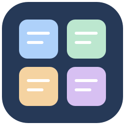
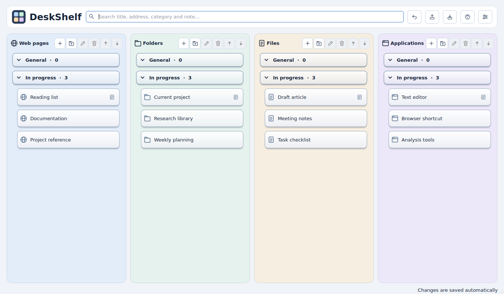

<p align="center"></p>
<h1 align="center">DeskShelf</h1>
<p align="center">A portable work shelf for picking up where you left off.</p>
<p align="center"><a href="README_FA.md">فارسی</a> · <a href="#download-and-run">Download and run</a> · <a href="#build-from-source">Build from source</a> · <a href="CONTRIBUTING.md">Contribute</a> · <a href="LICENSE">MIT license</a></p>

Do you keep dozens of browser tabs, folders, documents and programs open because
you are afraid of losing track of unfinished work? **DeskShelf gives those resources
a place to live after you close their windows.** Add them manually to four columns,
group them by task, and leave a note such as “continue reading section three.”
You can then shut down your computer and, the next day, find and open what you need
without rebuilding your working list from memory.

DeskShelf is a **manual organizer and launcher**. It does not record application
sessions, restore window positions, collect browser tabs automatically, or recover
unsaved documents. Save your work in the original applications before closing them.



*Interface preview with example entries; platform window decorations may differ.*

## Features

- Four independent, scrollable columns: web pages, folders, files and applications.
- Per-column collapsible categories, editable titles and notes, duplicate warnings.
- Saved category/item ordering via scoped drag-and-drop or Up/Down buttons.
- Same-type, single-column multiselection and reversible batch removal.
- Open entries by double-click or Enter; use Windows executable files and shortcuts.
- Drag-and-drop, cross-column search, complete-path copying and undo for removals.
- Automatic local saves, JSON backup/export and restore; no cloud account required.
- Pastel and standard palettes, independent column colors and border opacity.
- Clearly distinct flat and raised styles, comfortable and compact density.
- Customizable column order and widths; left-to-right paths in every interface.
- Twelve interface languages with an offline, searchable guide for each language.
- Portable Windows folder: no Python installation needed for the ready-made build.

## Quick links

- [Download the ready-to-run Windows version](https://github.com/Vahid-Nosrati/DeskShelf/releases/download/v0.4.0/DeskShelf-v0.4.0-windows-x64-portable.zip)
- [Download the source package](https://github.com/Vahid-Nosrati/DeskShelf/releases/download/v0.4.0/DeskShelf-v0.4.0-source.zip)
- [View all releases](https://github.com/Vahid-Nosrati/DeskShelf/releases)
- [Report a bug or suggest an improvement](https://github.com/Vahid-Nosrati/DeskShelf/issues)

## Download and run

Use the repository's **Releases** page. There are two different downloads:

| Download                                    | Best for                | What to do                                                        |
| ------------------------------------------- | ----------------------- | ----------------------------------------------------------------- |
| `DeskShelf-v0.4.0-windows-x64-portable.zip` | Run immediately         | Extract **all** contents, open `DeskShelf`, run `DeskShelf.exe`.  |
| `DeskShelf-v0.4.0-source.zip`               | Build or modify the app | Extract, install build prerequisites and run `build_windows.bat`. |

The source archive is included with this project. The Windows portable archive is
created on Windows and must be attached by the maintainer to the same release.
Do not mistake GitHub's automatic source downloads for the ready-made executable.

**Portable requirements:** 64-bit Windows 10; Windows 11 should be tested separately.
Choose a writable location, for example `D:\Apps\DeskShelf`. Keep the entire folder,
including `_internal` and the `data` folder created on first use. You may create a
shortcut to `DeskShelf.exe`; do not move just the executable out of its folder.
English is the first-run default; change it in **Settings → General**.

The previous Windows build occupied about **120 MB after extraction**. ZIP download
size and future release sizes vary. A local source build directory may be much larger
because it also contains Python packages and temporary build files.

## Build from source

1. Install 64-bit **Python 3.11, 3.12 or 3.13** with the Python Launcher (`py`).
2. Extract the source ZIP into a new, writable folder.
3. Double-click `build_windows.bat`. Internet is needed for dependencies unless you
   provide a complete `wheelhouse` of compatible wheels.
4. After “Build successful,” run `dist\DeskShelf\DeskShelf.exe`.
5. Keep **all of `dist\DeskShelf`** for everyday use. Once you have checked it works,
   `.venv` and `build` can be removed; they are not needed by the portable build.
   Keep the small source ZIP if you want to rebuild or edit the project later.

The script uses an isolated `.venv`; Anaconda is not required. It installs the
requirements, collects dependency notices and builds a PyInstaller onedir package.
It tries official PyPI, then the Tsinghua mirror on failure. To select a source in CMD:

```bat
set "DESKSHELF_INDEX_URL=https://mirrors.tuna.tsinghua.edu.cn/pypi/web/simple"
build_windows.bat
```

A timeout from `files.pythonhosted.org` concerns package download access, not pip
being out of date. The script uses a longer timeout and retries. For offline builds,
place **all** compatible dependency wheels in `wheelhouse`; if it contains wheels,
the script uses only that directory. Build Windows executables on Windows.
For development after dependencies are installed, use `run_windows.bat`.

## Using DeskShelf

Press **+** in a column, choose a category, enter a full path or URL, add a title and
optional note, and confirm. For local resources, use Browse or type the path. If a
web title is blank, DeskShelf tries to fetch it in the background; the URL is saved
even when fetching fails. This operation contacts the selected website.

Click category headings to expand or collapse. Select entries before editing or
removing them. Removing an entry never deletes the target file. Category removal
asks whether to move every contained entry to General or remove those DeskShelf entries too. User titles and notes stay as entered when you change
interface language.

| Shortcut | Action                                                   |
| -------- | -------------------------------------------------------- |
| Enter    | Open selected entry or expand/collapse selected category |
| F2       | Edit entry / rename category                             |
| Delete   | Remove entry or category after confirmation              |
| Ctrl+F   | Focus search                                             |
| Ctrl+Z   | Undo a whole removal batch during the current run             |
| F1       | Open the offline guide                                   |

The **Help** button contains the comprehensive guide and **About** tab in the selected
language. Windows-native file pickers may follow the Windows display language.

## Reordering and batch removal

Select one row and use the Up/Down buttons or drag it to a sibling. Categories can
move only within their own column; entries can move only within their own category.
A line marks the insertion point. General can move but cannot be renamed or removed.
Ordering is saved. Clear the search first; reordering is disabled during search and
while several rows are selected.

Use **Ctrl+click** for separate rows and **Shift+click** for a range. Selection is
restricted to one column and one type (categories OR entries). Selecting in another
column clears the previous selection; selecting the other type starts a new selection.
Entries from different categories of the same column can be selected together.
General is excluded from category removal batches. Editing and opening require a
single selection. Right-clicking a selected row preserves the current batch.

Delete asks for confirmation and displays the counts. For categories choose either:

- **Keep entries:** append them to General in their visible category/item order (default).
- **Remove entries too:** remove the categories and all entries inside them from DeskShelf.

The same choice applies to every selected category, including entries hidden by a
search. Original files/folders/apps are never deleted. Cancel leaves data unchanged.
**Undo / Ctrl+Z restores a whole removal batch with its previous order in one step.**
Up to 20 batches are retained during the current run; reorder and ordinary edits are
not deletion-undo actions.

Column controls stay beside the title when space permits and wrap below only when
needed. Up/Down controls have explicit arrowheads. The add/drop hint appears only
when the column contains no entries and no categories beyond General.

## Languages

English, فارسی, العربية, Español, Français, Deutsch, Português (Brasil), Русский,
简体中文, 日本語, Türkçe and हिन्दी. Persian and Arabic use a right-to-left interface.
Each locale has its own UI catalog in `locales/` and guide in `help/`.
Translations are open for community review and improvements; see [Contributing](CONTRIBUTING.md).

## Your data and updates

- `data/data.json`, beside the EXE, stores entries and settings automatically.
- `data/previous.json` contains only the state before the latest save; it is not a
  substitute for an exported backup.
- **Export Backup** writes a JSON file to your chosen location; **Restore Backup**
  replaces current entries and settings after confirmation.
- Close the app before moving its folder. Keep the whole folder and its data.
- Before updating, export a backup and copy `data`. Extract the new release into a
  different folder, run it and restore the backup. Confirm your entries before
  deleting the old copy. Backups from v0.1, v0.2 and v0.3 are accepted.
- Do not attach personal `data` or exported backups to public issues or releases.

## Troubleshooting

**Missing target:** edit its full path after moving a file, or reconnect the network
or removable drive. Check Windows default applications for the file type.

**Save errors:** use a writable folder. Do not keep the portable app in a protected
system directory. Keep your data safe before attempting manual recovery.

**Old taskbar icon:** unpin the old shortcut, launch the current EXE and pin it again.

**Already running:** only one process may use the same data folder at a time.

**Language/style:** changing flat/raised must not change text alignment. When reporting
an issue, include app version, interface language, style, Windows version and display
scale. Avoid screenshots containing private paths.

## Maintainer and release preparation

Author: **Vahid Nosrati**. Optional profile, repository and contact fields are blank.
Edit only their string values in **`app_info.json`**:
`github_profile`, `repository_url`, `public_contact`. Empty values are hidden.
The same file next to the portable EXE can be edited without rebuilding.
See [Maintainer setup](docs/MAINTAINER.md) for exact examples and publishing steps.

Run `package_release.bat` after a successful Windows build. It creates the source
and Windows portable ZIPs plus `SHA256SUMS.txt` in `release/`, excluding personal
`data` and development environments. Upload these as release assets, not the whole
working tree. Do not commit `dist`, `.venv`, `build` or personal data.

## Development and validation

```bat
.venv\Scripts\python.exe -m unittest discover -p "test_*.py" -v
```

Interface tests use Qt's offscreen backend. See [Changelog](CHANGELOG.md) for the
changes and validation limits. Windows execution, native file pickers, taskbar icons
and different display scales still require Windows testing. Other operating systems
are development/test environments, not supported public builds at this stage.

## License

DeskShelf source and original artwork: **MIT**, Copyright (c) 2026 Vahid Nosrati.
Read [LICENSE](LICENSE). Dependencies keep their own licenses; see
[Third-party notices](THIRD_PARTY_NOTICES.md) and `licenses/`.

To report a bug or request a feature, use this repository's Issues page. Translation
and code contributions are welcome. Names can be added voluntarily to [CONTRIBUTORS](CONTRIBUTORS).
